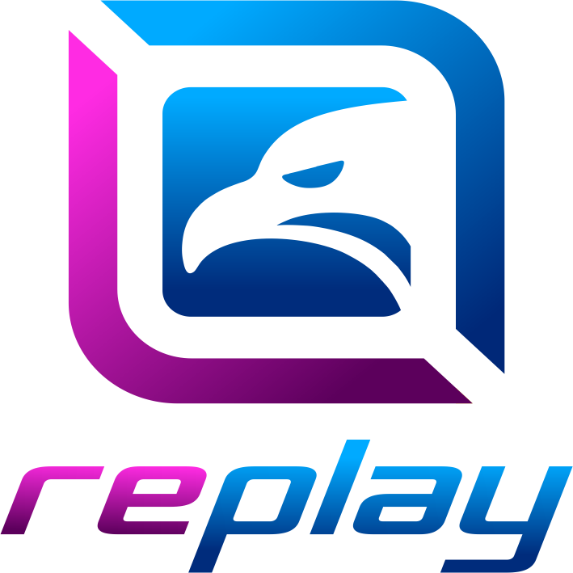

<div align="center">

  

  # ⚡ REPLAY BOS (Business Operating System)
  ### Enterprise NOC & ISP Operations Management Platform
  **PT. Replay Inti Media**

  <p align="center">
    Platform manajemen operasional terpadu untuk Internet Service Provider (ISP) & Network Operations Center (NOC). Mengintegrasikan helpdesk tiket gangguan, live public tracking client, portal teknisi lapangan, manajemen pelanggan & nomor layanan terstandarisasi, pengajuan upgrade/downgrade otomatis, monitoring resource server cPanel, hingga presensi karyawan anti-fraud ber-watermark resmi.
  </p>

  <p align="center">
    <a href="https://laravel.com"></a>
    <a href="https://vuejs.org"></a>
    <a href="https://inertiajs.com"></a>
    <a href="https://tailwindcss.com"></a>
    <a href="https://www.typescriptlang.org"></a>
    <a href="https://mariadb.org"></a>
    <a href="https://phpunit.de"></a>
    <a href="LICENSE"></a>
  </p>

  <p align="center">
    <a href="#-fitur-utama"><strong>Fitur Utama</strong></a> •
    <a href="#-teknologi--arsitektur"><strong>Teknologi</strong></a> •
    <a href="#-panduan-instalasi--quick-start"><strong>Instalasi</strong></a> •
    <a href="#-panduan-deployment-cpanel-hosting"><strong>Deployment cPanel</strong></a> •
    <a href="#-hak-akses--role-management"><strong>Hak Akses</strong></a> •
    <a href="LOG_PERUBAHAN.md"><strong>Log Perubahan</strong></a>
  </p>

</div>

---

## 🌟 Tentang Replay BOS

**Replay BOS (Business Operating System)** adalah sistem manajemen terpadu yang dibangun untuk mengotomatiskan dan menyederhanakan alur kerja di seluruh divisi **PT. Replay Inti Media**. Sistem ini menghubungkan divisi **NOC, Helpdesk, Teknisi Lapangan, Marketing, Finance, dan Human Resource (HR)** ke dalam satu ekosistem komando yang saling terhubung secara *real-time*.

Dengan arsitektur modern **Hybrid Blade + Inertia.js Vue 3 + TypeScript**, aplikasi ini menggabungkan kecepatan server-side rendering Laravel dengan interaktivitas frontend reaktif Vue 3.

---

## 🚀 Fitur Utama

```
┌────────────────────────────────────────────────────────────────────────┐
│                        REPLAY BOS CORE PLATFORM                        │
├───────────────────┬────────────────────┬───────────────────────────────┤
│ 🎫 Ticketing &    │ 🛠️ Field Tech      │ 📸 Employee Portal &          │
│    Public Share   │    Operations      │    Watermarked Attendance     │
├───────────────────┼────────────────────┼───────────────────────────────┤
│ 👥 Master Client  │ 📈 Package Upgrade │ 📊 Database & Server          │
│    Numeric Pad    │    & Finance Flow  │    Resource Monitoring        │
└───────────────────┴────────────────────┴───────────────────────────────┘
```

### 1. 🎫 Manajemen Tiket Gangguan & Helpdesk Pintar
- **Siklus Status Lengkap:** Alur kerja tiket terstruktur mulai dari `OPEN` ➜ `PENDING` ➜ `HANDLE` ➜ `SOLVED` ➜ `CLOSED`.
- **Standarisasi 8 Kategori Gangguan:** *Link Down, Gangguan Bandwidth, High Latency / Intermitten, Aktivasi, Dismantle, Upgrade, Downgrade,* dan *Non Gangguan*.
- **Penomoran Tiket Otomatis:** Identifikasi segmen pelanggan berbasis prefix resmi: Corporate (`CP-`), Reseller (`RS-`), dan Home (`RH-`).
- **Timeline Progress Update dengan Foto:** Teknisi atau admin NOC dapat melampirkan foto perkembangan perbaikan secara bertahap di timeline internal.
- **Generator RFO (Reason For Outage):** Dokumentasi penyebab gangguan, tindakan korektif, dan ringkasan RFO otomatis saat tiket berstatus Solved/Closed.
- **Auto-Fill WhatsApp Notification:** Pembuatan pesan ringkasan update tiket siap kirim ke WhatsApp pelanggan dengan 1 klik.

### 2. 📱 Live Tracking Client (Smartphone Mockup View)
- **Tautan Sharelink Publik Permanen:** Pelanggan dapat memantau tiket melalui link unik yang **tidak kadaluarsa** meskipun status tiket telah closed.
- **Desain Smartphone Mockup Interaktif:** Tampilan visual adaptif menyerupai layar handphone modern yang elegan dan ramah layar sentuh.
- **Anti-Overflow & Presisi Text:** Jaminan tampilan balon catatan timeline dan dokumen RFO terbungkus rapi tanpa scroll horizontal yang merusak layout.

### 3. 🛠️ Portal Teknisi Lapangan (`/portal-teknisi`)
- **Dashboard Operasional Teknisi:** Menampilkan rangkuman tugas aktif (*Work Order Scheduled & In Progress*), tiket perbaikan tim, riwayat kunjungan lapangan, serta status presensi harian.
- **Role & Permission Mandiri:** Role **Teknisi** terdaftar resmi di menu *Roles & Permissions*, siap dikelola dan didelegasikan izin hak aksesnya secara mandiri oleh Super Admin.
- **Sidebar Khusus Teknisi:** Navigasi cepat langsung menuju modul tugas kerja lapangan.

### 4. 📸 Presensi Karyawan Anti-Fraud & Watermark Canvas 2D
- **Wajib Kamera Langsung (Live Camera Only):** Mengeliminasi celah manipulasi kehadiran; opsi upload foto lokal dari galeri file telah dihapus total.
- **Standardisasi Watermark Resmi Replay (Canvas 2D):**
  - Logo resmi Replay Network Indonesia di pojok foto.
  - Nama legal instansi: `PT. Replay Inti Media`.
  - Timestamp waktu aktual zona WIB hingga satuan detik (*real-time*).
  - Titik koordinat GPS (`Latitude, Longitude`).
  - Alamat lengkap hasil reverse-geocoding OpenStreetMap Nominatim.
  - Overlay gradient gelap pelindung keterbacaan teks tanpa menutupi wajah.
- **Portal Karyawan Vue 3 Inertia (`/portal-karyawan`):** Ringkasan kartu absensi hari ini, riwayat presensi, dan modal Lightbox zoom foto resolusi penuh.

### 5. 📈 Pengajuan Upgrade & Downgrade Paket Layanan
- **Formulir Interaktif:** Pengajuan dari divisi Marketing/NOC dilengkapi filter kategori client interaktif (*Reseller, Corporate, Home*).
- **Dukungan Bebas Ketik (*Custom Typed Package*):** Pemilihan paket tujuan dapat dipilih dari katalog standar atau diketik bebas dengan saran autocomplete.
- **Workflow Persetujuan Finance:**
  - Penetapan tarif langganan bulanan baru dilakukan secara sah oleh Finance saat proses *approval*.
  - Otomatis memperbarui paket pelanggan di master data `Customer`.
  - Otomatis men-generate nomor **Work Order** penanganan teknisi lapangan tanpa entri ulang.

### 6. 📊 Monitoring Resource Database cPanel Server (`/resources`)
- **Visualisasi Kapasitas Real-Time:** Menampilkan metrik ukuran total database, ukuran indeks data, overhead fragmentasi, pemakaian disk hosting, dan persentase kapasitas.
- **Statistik Server & Lingkungan PHP:** Monitoring jumlah thread koneksi aktif vs `max_connections`, memory usage PHP, memory limit, dan performa database query.
- **Inspeksi 48+ Tabel Database:** Menampilkan engine tabel, jumlah baris, ukuran data, overhead, serta tombol aksi **Optimasi Tabel** (`OPTIMIZE TABLE`) per-tabel maupun serentak.

### 7. 👥 Standarisasi Nomor Layanan Client & Import Spreadsheet
- **Format Nomor Numerik Murni:** Standarisasi nomor pelanggan berawalan angka tetap dengan padding urut mandiri:
  - **Reseller:** `920210000[Urut]` (contoh: `9202100001`, `9202100002`)
  - **Corporate:** `920220000[Urut]` (contoh: `9202200001`, `9202200002`)
  - **Home:** `920230000[Urut]` (contoh: `9202300001`, `9202300002`)
- **Import Pelanggan Cepat:** Input data masal via spreadsheet Microsoft Excel (`.xlsx`, `.xls`) dan CSV dengan auto-generator nomor layanan.
- **CLI Penyelarasan Otomatis:** Perintah Artisan `php artisan customers:align-service-numbers` untuk menyelaraskan urutan nomor jika terjadi loncatan data.

### 8. 📑 Modul Surat Penawaran (Quotation) & Standarisasi Karyawan
- **Input Harga Satuan Readonly & Format Titik:** Harga satuan pada pembuatan penawaran otomatis terkunci sesuai katalog paket layanan dan berformat titik ribuan (`3.000.000`).
- **Standardisasi Identitas BPJS:** Penyeragaman label resmi `Nomor BPJS Ketenagakerjaan` dan `Nomor BPJS Kesehatan` di seluruh formulir master karyawan dan portal profil.

### 9. ☁️ Keandalan Storage & Kompatibilitas Hosting cPanel
- **Endpoint Perbaikan Cerdas (`/storage-link`):** Memastikan direktori target ada, menginisialisasi subfolder `employees/photos` dan `attendances` (0775), membersihkan dead symlink, serta menyajikan audit kesehatan storage secara visual.
- **Rute Fallback Direct-Serving (`/storage/{path}`):** Melayani aset foto langsung dari controller jika provider hosting cPanel menonaktifkan fungsi native `symlink`, menjamin foto tidak pernah mengalami *broken image* (404).

---

## 💻 Teknologi & Arsitektur

Replay BOS dirancang dengan standar arsitektur clean and secure:

| Layer | Teknologi | Keterangan |
|:---|:---|:---|
| **Backend Core** | **Laravel 12 / PHP 8.2+** | Robust MVC framework, Eloquent ORM, Gates & Policies, Form Requests |
| **Frontend Framework** | **Inertia.js v3.8 + Vue 3.5** | Single Page Application (SPA) experience tanpa API layer terpisah |
| **Templating Engine** | **Laravel Blade** | Hybrid server-side rendering untuk halaman administrasi & cetak PDF |
| **Styling & CSS** | **Tailwind CSS v4 + Bootstrap 5** | Antarmuka modern, custom dark sidebar, komponen interaktif, utilitas responsif |
| **Type Safety** | **TypeScript 5.9** | Definisi model tipe data pada layer Vue & Inertia |
| **Database** | **MariaDB / MySQL 8.0+** | Transaksi ACID, relasi foreign key, optimasi index query |
| **Asset Bundler** | **Vite 7.0 + Rollup** | Hot Module Replacement (HMR) super cepat & optimized production build |
| **Dokumen & Media** | **DomPDF & HTML5 Canvas** | Generate surat penawaran PDF & burned-in image watermark |
| **Testing** | **PHPUnit 11** | 48 automated feature & unit tests (216 assertions passed) |

---

## ⚙️ Panduan Instalasi (Quick Start)

### 1. Kebutuhan Sistem
Pastikan server lokal atau production Anda telah terpasang:
- **PHP** >= 8.2 (ekstensi: `pdo_mysql`, `mbstring`, `fileinfo`, `gd`, `zip`, `xml`)
- **Composer** >= 2.6
- **Node.js** >= 18.x & **NPM**
- **MariaDB** >= 10.4 atau **MySQL** >= 8.0

### 2. Langkah Instalasi di Localhost

```bash
# 1. Clone repositori ke direktori kerja Anda
git clone https://github.com/replaydeveloper77-web/replay-bos.git
cd replay-bos

# 2. Pasang dependensi PHP melalui Composer
composer install

# 3. Gandakan file environment dan buat application key
cp .env.example .env
php artisan key:generate

# 4. Konfigurasikan koneksi database pada file .env
# DB_CONNECTION=mysql
# DB_HOST=127.0.0.1
# DB_PORT=3306
# DB_DATABASE=replay_bos
# DB_USERNAME=root
# DB_PASSWORD=

# 5. Jalankan migrasi database dan database seeder
php artisan migrate --seed

# 6. Pasang dependensi JavaScript & kompilasi aset frontend
npm install
npm run build

# 7. Hubungkan storage symlink
php artisan storage:link

# 8. Jalankan local development server
php artisan serve
```

Aplikasi kini dapat diakses di browser melalui tautan: `http://localhost:8000`.

---

## 🌐 Panduan Deployment (cPanel Hosting)

Bagi instalasi di server shared hosting atau cPanel yang **tidak memiliki akses terminal SSH / Composer**:

1. **Upload Source Code:**
   - Upload seluruh folder project (atau arsip zip) ke direktori server hosting Anda (misal: `public_html` atau root sub-domain).
2. **Ekstrak Vendor Package:**
   - Proyek ini telah dilengkapi file [`vendor.zip`](vendor.zip) (~43 MB) berisi paket dependensi PHP utuh. Ekstrak file tersebut di root folder project via **cPanel File Manager** ➜ **Extract**.
3. **Konfigurasi `.env` Hosting:**
   - Sesuaikan nama database, user DB cPanel, password, dan `APP_URL` dengan domain aktif.
4. **Setup Database:**
   - Import file database SQL awal melalui **phpMyAdmin** cPanel.
5. **Inisialisasi & Perbaikan Storage Symlink:**
   - Buka browser dan akses URL:
     ```
     https://domain-anda.com/storage-link
     ```
   - Halaman akan secara otomatis membuat direktori foto, menguji izin tulis folder, dan menyambungkan symlink storage.
   - *Catatan:* Jika hosting Anda melarang fungsi symlink native, rute fallback `/storage/{path}` akan otomatis aktif sehingga gambar tetap tampil sempurna 100%.

---

## 🧪 Pengujian Sistem (Automated Tests)

Replay BOS dilengkapi pengujian otomatis berkala untuk menjaga keandalan fitur dan mencegah regresi kode:

```bash
php artisan test
```

**Hasil Pengujian:**
```
PASS  Tests\Unit\ExampleTest
PASS  Tests\Feature\AttendanceDetailPhotoAndLocationTest
PASS  Tests\Feature\CustomerImportTest
PASS  Tests\Feature\CustomerServiceNumberTest
PASS  Tests\Feature\DatabaseResourceTest
PASS  Tests\Feature\PackageChangeRequestTest
PASS  Tests\Feature\PortalTeknisiTest
PASS  Tests\Feature\QuotationUnitPriceTest
PASS  Tests\Feature\TicketProgressUpdateTest

Tests:    48 passed (216 assertions)
Duration: 3.92s
```

---

## 👥 Manajemen Role & Hak Akses

| Modul & Fitur | Super Admin | NOC Admin | Finance | Marketing | Teknisi | Karyawan |
|:---|:---:|:---:|:---:|:---:|:---:|:---:|
| **Manajemen Tiket (Helpdesk)** | ✅ | ✅ | 👁️ Read | 👁️ Read | 👁️ Read | ❌ |
| **Progress Timeline & RFO** | ✅ | ✅ | ❌ | ❌ | ✅ | ❌ |
| **Portal Teknisi (`/portal-teknisi`)** | ✅ | 👁️ Read | ❌ | ❌ | ✅ | ❌ |
| **Data Pelanggan (Import & Edit)** | ✅ | ✅ | 👁️ Read | ✅ | ❌ | ❌ |
| **Pengajuan Upgrade/Downgrade** | ✅ | ✅ | 👁️ Read | ✅ | ❌ | ❌ |
| **Approval Upgrade (Finance)** | ✅ | ❌ | ✅ | ❌ | ❌ | ❌ |
| **Monitoring Resource Database** | ✅ | ✅ | ❌ | ❌ | ❌ | ❌ |
| **Data Karyawan & Master Role** | ✅ | ❌ | ❌ | ❌ | ❌ | ❌ |
| **Portal Karyawan & Presensi Live** | ✅ | ✅ | ✅ | ✅ | ✅ | ✅ |

---

## 📁 Struktur Direktori Utama

```
replay-bos/
├── app/
│   ├── Console/Commands/       # Artisan Commands (Align numbers, dll)
│   ├── Http/Controllers/       # Ticket, Customer, Attendance, Teknisi, Resources
│   ├── Http/Requests/          # Form Requests Validasi
│   ├── Models/                 # Eloquent Models (Ticket, Customer, Attendance, WO)
│   ├── Policies/               # Otorisasi Hak Akses Gate
│   └── Services/               # Business Logic Services terisolasi
├── database/
│   ├── migrations/             # Schema Database
│   └── seeders/                # Data Master & Akun Awal
├── public/
│   ├── images/branding/        # Logo Resmi & Favicon Replay
│   └── build/                  # Production Compiled Assets (Vite)
├── resources/
│   ├── js/                     # Vue 3 Inertia Components & Layouts
│   │   ├── Layouts/AppLayout.vue
│   │   └── Pages/PortalKaryawan/
│   └── views/                  # Blade Views (Tickets, Attendance, Resources)
├── routes/
│   └── web.php                 # Routing Web, Symlink Diagnostic & Fallback
├── tests/
│   └── Feature/                # Automated Feature Test Suite
└── LOG_PERUBAHAN.md            # Riwayat Perubahan & Catatan Rilis Terinci
```

---

## 📄 Hak Cipta & Lisensi

Sistem ini dikembangkan secara eksklusif untuk operasional **PT. Replay Inti Media**.  
Source code dilisensikan di bawah lisensi [MIT](LICENSE).

<div align="center">
  <sub>Copyright © 2026 <strong>PT. Replay Inti Media (Replay Net)</strong>. All rights reserved.</sub>
</div>
